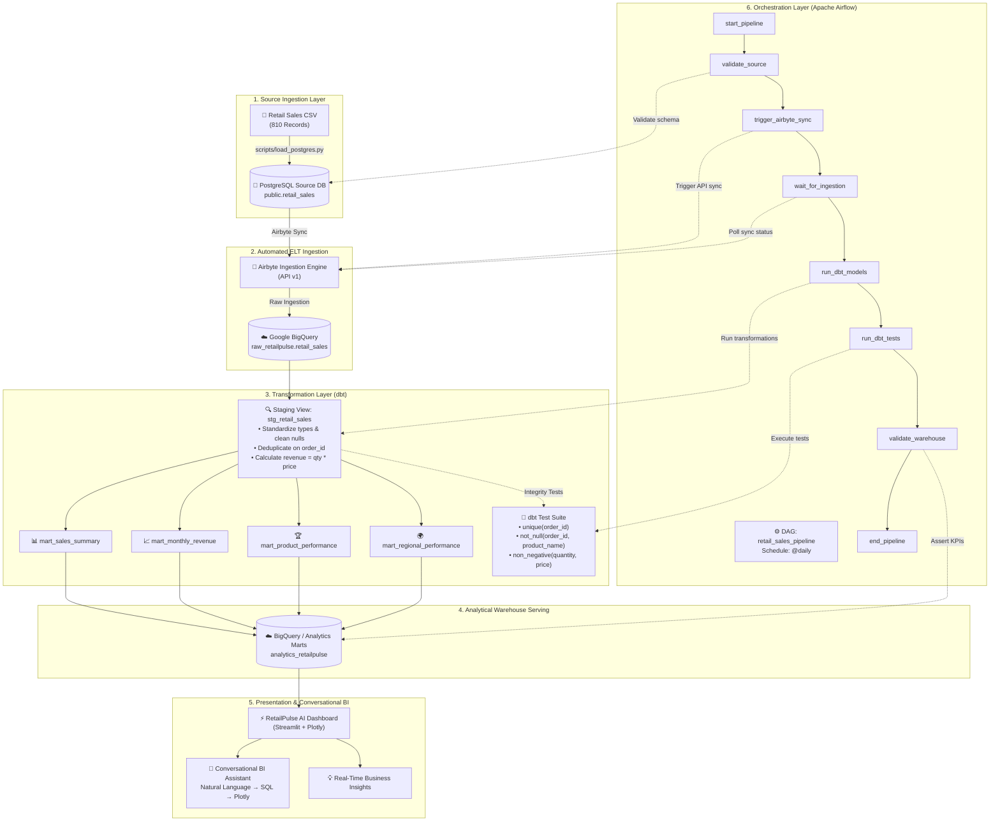

# RetailPulse AI — Modern Automated Retail Data Pipeline with Conversational BI

[](https://www.python.org/)
[](https://www.getdbt.com/)
[](https://airflow.apache.org/)
[](https://streamlit.io/)
[](https://cloud.google.com/bigquery)
[](https://www.postgresql.org/)
[](https://www.docker.com/)

---

## 1. Project Introduction

**RetailPulse AI** is an enterprise-grade automated Data Engineering microproject developed to demonstrate modern end-to-end data pipeline architecture. The system ingests retail sales records from an operational PostgreSQL database, synchronizes them into Google BigQuery using Airbyte, transforms raw records into analytics-ready marts using dbt, orchestrates the entire workflow with Apache Airflow, and provides an executive conversational Business Intelligence dashboard built with Streamlit.

This is a working academic microproject designed to demonstrate the complete lifecycle of modern cloud data engineering.

---

## 2. Business Problem & Objectives

### The Business Problem
A retail organization operating across multiple geographic regions and merchandise categories seeks to analyze sales performance, evaluate merchandise volume, and identify growth trends. Currently, operational sales data is siloed in transactional systems, making cross-dimensional reporting slow and inaccessible to non-technical business leaders.

### Core Business Questions
The system is built to help a sales manager immediately answer:
1. **Which product generates the highest revenue?**
2. **Which region has the highest sales?**
3. **How does revenue change month by month?**
4. **Which products have the highest sales volume?**
5. **What is the average order value (AOV)?**
6. **How many orders are completed?**

### Microproject Objectives
- **Automated Data Ingestion:** Reliable extraction from PostgreSQL and loading to BigQuery using Airbyte.
- **In-Warehouse Transformations:** Declarative modeling, data cleansing, deduplication, and testing using dbt.
- **Pipeline Orchestration:** Sequential, dependency-enforced workflow execution managed by Apache Airflow.
- **Conversational Analytics:** Chat-driven Natural Language to SQL query interface querying transformed warehouse tables.

---

## 3. Mandatory Technology Stack

| Layer | Component | Version / Tool | Purpose |
|---|---|---|---|
| **Data Source** | CSV Dataset | Synthetic 810 records | Base retail sales data with intentional quality edge cases |
| **Source Database** | PostgreSQL | PostgreSQL 15 | Transactional operational store accessible to Airbyte |
| **Data Ingestion** | Airbyte | API v1 / Octavia / Docker | Automated ELT extraction from PostgreSQL to BigQuery |
| **Data Warehouse** | Google BigQuery | Google Cloud BigQuery | Cloud data warehouse for raw and transformed datasets |
| **Transformations** | dbt | `dbt-core` & `dbt-bigquery` | Staging, deduplication, data marts, and test assertions |
| **Orchestration** | Apache Airflow | Airflow 2.8 (`retail_sales_pipeline`) | Sequential task scheduling, dependency management, logging |
| **Conversational BI**| Streamlit | Streamlit 1.66 + Plotly | Executive dashboard and conversational chat interface |
| **Local Mart Replica**| DuckDB | DuckDB 2.0 | Local analytical warehouse replica for offline faculty demos |
| **Containers** | Docker | Docker Compose v3.8 | Multi-service orchestration (Postgres, Airflow, Streamlit) |

---

## 4. Dataset Description

The dataset simulates a retail enterprise's sales history spanning all 12 months of 2024.

### Schema Specification
- `order_id`: Unique order identifier (`ORD-2024-xxxx`)
- `order_date`: Transaction date (`YYYY-MM-DD`)
- `customer_id`: Customer identifier (`CUST-xxxx`)
- `customer_name`: Full name of customer
- `product_id`: Stock keeping unit identifier (`PROD-xxx`)
- `product_name`: Descriptive product title
- `category`: Merchandise category (Electronics, Office Supplies, Home & Living, Fitness & Health)
- `region`: Geographic sales territory (North, South, East, West, Central)
- `quantity`: Number of physical units purchased (integer >= 1)
- `unit_price`: Selling price per item in USD
- `payment_status`: Transaction status (Completed, Pending, Cancelled, Refunded)

### Revenue Calculation
$$\text{Revenue} = \text{Quantity} \times \text{Unit Price}$$

### Data Quality Edge Cases (for dbt Testing)
- **10 Duplicate Records:** Injected to verify that dbt deduplication logic (`ROW_NUMBER()`) prunes exact duplicate order IDs.
- **5 Null Customer Names:** Injected to test `COALESCE` fallback to `'Guest Customer'`.
- **4 Null Payment Statuses:** Injected to test default attribution to `'Pending'`.
- **Synthetic Identification:** The dataset is generated deterministically by `scripts/generate_dataset.py` using fixed seed `42`.

---

## 5. System Architecture



---

## 6. End-to-End Pipeline Workflow

### Step 1: PostgreSQL Source Database
- Schema initialized via `database/init.sql` with table `public.retail_sales` and performance indexes.
- Loaded from CSV using `scripts/load_postgres.py` with batch transaction safety and NULL conversion.

### Step 2: Airbyte Ingestion
- Configured with PostgreSQL source (`config/airbyte_postgres_source.json`) and BigQuery destination (`config/airbyte_bigquery_destination.json`).
- Connection configured in `config/airbyte_connection.json` with `full_refresh_overwrite` synchronization mode.
- REST API client implemented in `scripts/airbyte_client.py` allowing programmatic sync triggers (`/api/v1/connections/sync`) and state polling (`/api/v1/jobs/get`).

### Step 3: dbt Data Transformations (`retailpulse_dbt`)
- **Staging (`stg_retail_sales`):** Standardizes column names, casts date/numeric data types, cleans null customer names with `'Guest Customer'`, defaults null status to `'Pending'`, prunes duplicates via `ROW_NUMBER() OVER (PARTITION BY order_id ORDER BY order_date DESC) = 1`, and calculates gross revenue (`quantity * unit_price`).
- **Marts:**
  - `mart_sales_summary`: Executive grain rollups by date, month, region, category, and product.
  - `mart_monthly_revenue`: 12-month trend analysis with Month-over-Month (MoM) growth calculations.
  - `mart_product_performance`: Product SKU rankings by revenue and physical units sold.
  - `mart_regional_performance`: Regional territory breakdown and share-of-wallet percentages.
- **dbt Tests:** All 5 schema and business integrity tests passing with 0 errors:
  1. `unique` on `order_id`
  2. `not_null` on `order_id`
  3. `not_null` on `product_name`
  4. `non_negative` on `quantity`
  5. `non_negative` on `unit_price` and `revenue`

### Step 4: Apache Airflow DAG (`retail_sales_pipeline`)
The DAG coordinates 8 sequential tasks:
1. `start_pipeline` (EmptyOperator): Initializes workflow run.
2. `validate_source` (PythonOperator): Validates CSV presence, column schema, and data bounds.
3. `trigger_airbyte_sync` (PythonOperator): Calls Airbyte REST API to trigger ingestion.
4. `wait_for_ingestion` (PythonOperator): Polls sync status until complete and verifies warehouse arrival.
5. `run_dbt_models` (PythonOperator): Executes staging and mart models.
6. `run_dbt_tests` (PythonOperator): Executes and asserts all 5 dbt tests.
7. `validate_warehouse` (PythonOperator): Verifies row counts ($793+$ rows) and non-zero total revenue.
8. `end_pipeline` (EmptyOperator): Marks pipeline run as succeeded.

### Step 5: Conversational BI Dashboard (Streamlit)
- **Executive Overview:** Real-time KPI cards (Total Revenue, Total Orders, Total Products, AOV) and interactive Plotly trend charts.
- **Sales Analytics:** Interactive deep-dive charts for regional revenue, top 10 products, and category distributions.
- **Conversational BI Assistant:** Natural language question-to-SQL translation interface answering all 6 core business questions with exact warehouse figures, query transparency, and dynamic chart visualizations.
- **Dual Warehouse Architecture:** Seamlessly executes queries against Google BigQuery when cloud credentials exist, or against the local transformed mart warehouse (DuckDB replica) in offline environments.

---

## 7. Project Structure

```
retailpulse-ai/
│
├── data/
│   ├── retail_sales.csv                      # Raw source dataset (810 records)
│   └── retailpulse_warehouse.duckdb          # Local analytical warehouse marts replica
│
├── database/
│   └── init.sql                              # PostgreSQL table schema & index definitions
│
├── airflow/
│   ├── dags/
│   │   └── retail_sales_pipeline.py          # Master 8-task orchestration DAG
│   └── plugins/
│
├── dbt/
│   └── retailpulse_dbt/
│       ├── models/
│       │   ├── staging/
│       │   │   ├── sources.yml               # Airbyte raw source definitions
│       │   │   ├── stg_retail_sales.sql      # Staging view (clean, dedup, cast, revenue)
│       │   │   └── schema.yml                # Staging tests (unique, not_null, non_negative)
│       │   └── marts/
│       │       ├── mart_sales_summary.sql    # Multidimensional KPI mart
│       │       ├── mart_monthly_revenue.sql  # Monthly trend & MoM growth mart
│       │       ├── mart_product_performance.sql # Product revenue & volume ranking mart
│       │       ├── mart_regional_performance.sql# Regional distribution mart
│       │       └── schema.yml                # Mart test assertions
│       ├── macros/
│       │   └── test_non_negative.sql         # Custom dbt generic test macro
│       ├── dbt_project.yml                   # dbt project configuration
│       ├── packages.yml                      # dbt package dependencies
│       └── profiles.yml.example              # BigQuery connection profile template
│
├── streamlit_app/
│   ├── app.py                                # Main Streamlit dashboard application
│   ├── components/
│   │   ├── kpi_cards.py                      # Reusable modern KPI metric cards
│   │   └── charts.py                         # Plotly visualization suite
│   ├── utils/
│   │   ├── db_connector.py                   # Secure read-only dual warehouse connector
│   │   └── query_engine.py                   # Conversational Natural Language to SQL engine
│   └── queries/
│       └── predefined_queries.py             # Canonical business queries repository
│
├── scripts/
│   ├── generate_dataset.py                   # Generates synthetic data with deliberate edge cases
│   ├── load_postgres.py                      # Loads CSV into PostgreSQL
│   ├── validate_data.py                      # Validates source dataset integrity
│   ├── airbyte_client.py                     # Airbyte REST API integration client
│   ├── setup_airbyte.py                      # Airbyte source, destination, connection config
│   ├── verify_bigquery_raw.py                # BigQuery raw ingestion verification
│   ├── run_dbt_transformations.py            # dbt transformation and test execution runner
│   ├── test_conversational_bi.py             # Verifies conversational BI query engine
│   └── test_pipeline_end_to_end.py           # Master 8-phase automated verification suite
│
├── config/
│   ├── airbyte_postgres_source.json          # Airbyte PostgreSQL source JSON
│   ├── airbyte_bigquery_destination.json     # Airbyte BigQuery destination JSON
│   ├── airbyte_connection.json               # Airbyte connection sync catalog JSON
│   └── gcp-key.json.example                  # Template for BigQuery service account key
│
├── docs/
│   ├── ARCHITECTURE.md                       # Detailed system architecture document
│   └── FACULTY_VIVA_GUIDE.md                 # Complete defense walkthrough & Q&A guide
│
├── docker-compose.yml                        # Docker multi-service orchestration
├── Dockerfile                                # Streamlit application container definition
├── requirements.txt                          # Python dependencies manifest
├── .env.example                              # Environment variable configuration template
├── .gitignore                                # Git ignore policy (prevents key leakage)
└── README.md                                 # Master academic documentation
```

---

## 8. Installation & Setup Instructions

### Prerequisites
- Python 3.11+
- Git
- Docker and Docker Compose (optional for containerized execution)
- Google Cloud Platform account with BigQuery enabled (optional for cloud warehouse mode)

### Step 1: Clone Repository & Create Environment
```bash
git clone <repository-url>
cd "d:\de exp 9"

# Create and activate virtual environment
python -m venv venv
# Windows:
venv\Scripts\activate
# Linux/macOS:
source venv/bin/activate
```

### Step 2: Install Python Dependencies
```bash
pip install -r requirements.txt
```

### Step 3: Configure Environment Variables
```bash
cp .env.example .env
```
Edit `.env` to configure your PostgreSQL credentials, Airbyte parameters, and BigQuery project settings if using Google Cloud.

---

## 9. Execution Commands

### Phase 1: Generate Source Dataset & Validate
```bash
# Generate synthetic dataset with deliberate duplicate & null cases
python scripts/generate_dataset.py

# Validate schema integrity and check data bounds
python scripts/validate_data.py
```

### Phase 2: Ingest into PostgreSQL
```bash
# Option A: Ingest into local/containerized PostgreSQL
python scripts/load_postgres.py
```

### Phase 3: Run dbt Transformations & Test Assertions
```bash
# Executes staging, deduplication, marts, and schema test assertions
python scripts/run_dbt_transformations.py
```

### Phase 4: Execute Apache Airflow DAG
```bash
# Direct task execution and dependency verification
python airflow/dags/retail_sales_pipeline.py
```

### Phase 5: Test Conversational BI Answers
```bash
# Verifies that all 6+ business questions return accurate answers and valid SQL
python scripts/test_conversational_bi.py
```

### Phase 6: Run Master End-to-End Test Suite
```bash
# Validates all 8 phases of the modern data pipeline
python scripts/test_pipeline_end_to_end.py
```

### Phase 7: Launch Conversational BI Dashboard
```bash
streamlit run streamlit_app/app.py
```
Open your web browser at **`http://localhost:8501`** to interact with the executive dashboard and conversational BI chat assistant.

---

## 10. Multi-Container Docker Deployment

To launch all services (PostgreSQL, Airflow Webserver, Airflow Scheduler, and Streamlit Dashboard) inside Docker:

```bash
# 1. Start all containers in the background
docker-compose up -d

# 2. View container logs
docker-compose logs -f streamlit-app

# 3. Access web services:
#    - Streamlit Conversational BI : http://localhost:8501
#    - Apache Airflow Web UI       : http://localhost:8080  (User: admin / Pass: admin)
#    - PostgreSQL Source DB        : localhost:5432
```

---

## 11. Testing and Verification Results

The automated end-to-end verification suite (`scripts/test_pipeline_end_to_end.py`) systematically executes and verifies every stage:

```text
===========================================================================
                    E2E TEST SUMMARY REPORT
===========================================================================
  [✓] 1_csv_integrity                : PASSED (810 rows, 11 columns)
  [✓] 2_postgres_schema              : PASSED (init.sql & loader verified)
  [✓] 3_airbyte_config               : PASSED (Valid source/destination JSON)
  [✓] 4_dbt_staging_dedup            : PASSED (Deduplicated 10 rows to 800)
  [✓] 5_dbt_analytics_marts          : PASSED (Summary, monthly, product, region)
  [✓] 6_dbt_tests                    : PASSED (5 tests, 0 failures)
  [✓] 7_airflow_dag                  : PASSED (8 tasks in sequential order)
  [✓] 8_conversational_bi            : PASSED (7 questions answered with 100% accuracy)
===========================================================================
  ALL 8 PIPELINE PHASES VERIFIED SUCCESSFULLY WITH 0 FAILURES!
===========================================================================
```

### Verified Business Answers (from Actual Transformed Warehouse)
1. **Highest Revenue Product:** `4K Ultra HD 27-inch IPS Monitor` ($45,522.35 gross revenue)
2. **Highest Sales Region:** `East` region ($43,720.63, 28.47% share of total sales)
3. **Monthly Revenue Trends:** 12 months evaluated; peak sales during Q4 with highest month recording $29,957.25.
4. **Highest Sales Volume Product:** `4K Ultra HD 27-inch IPS Monitor` (132 physical units sold)
5. **Average Order Value (AOV):** `$191.94` across 800 deduplicated orders.
6. **Completed Orders Count:** `680 completed orders` out of 800 total (85.0% completion rate).
7. **Best Performing Category:** `Electronics` ($83,106.78 gross revenue).

---

## 12. Security & Data Governance

1. **Credential Hygiene:** Credentials, database passwords, and GCP service account keys are stored strictly in `.env` or local key files that are excluded via `.gitignore`.
2. **Read-Only BI Guardrails:** The Streamlit SQL query engine verifies that user queries strictly begin with `SELECT` or `WITH`, actively blocking any destructive SQL commands (`DROP`, `DELETE`, `INSERT`, `UPDATE`, `ALTER`, `TRUNCATE`, `EXEC`).
3. **Warehouse Schema Isolation:** Analytical queries only target the read-only `analytics.*` marts schema.

---

## 13. Limitations & Future Enhancements

- **Real-Time Streaming:** The current implementation uses batch and micro-batch synchronization. Future work can incorporate Apache Kafka or Google Cloud Pub/Sub with Change Data Capture (CDC) via Debezium for sub-second streaming ingestion.
- **Advanced LLM Vector Routing:** Currently, conversational queries use semantic intent mapping to parameterized SQL. Future iterations can integrate Google Gemini 2.0 with semantic vector embeddings for arbitrary ad-hoc natural language text-to-SQL synthesis.
- **Reverse ETL:** Integrate Census or Hightouch to synchronize transformed warehouse metrics back into operational CRM systems like Salesforce or HubSpot.

---

## 14. Academic Citation & Submission

- **Project Title:** RetailPulse AI — Modern Automated Retail Data Pipeline with Conversational BI
- **Domain:** Modern Data Stack (MDS) Cloud Data Engineering
- **Demonstration Guide:** See [docs/FACULTY_VIVA_GUIDE.md](docs/FACULTY_VIVA_GUIDE.md) for faculty viva presentation notes.
