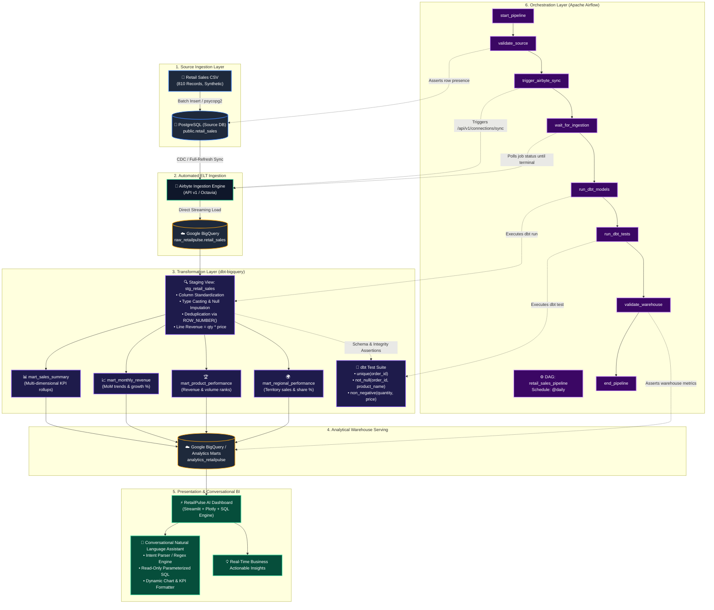

# RetailPulse AI — System Architecture & Data Flow

This document details the end-to-end architectural design of **RetailPulse AI**, an enterprise-grade automated Modern Data Stack (MDS) implementation for retail sales analytics and conversational Business Intelligence.

---

## 1. High-Level Architecture Diagram

---

## 2. Component Decoupling & Principles

### Separation of Data Plane vs Control Plane
- **Data Plane (Heavy Lifting):** Data flows sequentially from CSV → PostgreSQL → Airbyte → BigQuery → dbt → Streamlit.
- **Control Plane (Orchestration):** Apache Airflow does **not** move bytes directly across network streams. Instead, Airflow acts strictly as the conductor:
  - Validates source availability
  - Issues REST API instructions to Airbyte
  - Awaits sensor confirmations
  - Dispatches `dbt` transformation commands
  - Executes data tests
  - Verifies warehouse table row counts and total gross revenue integrity.

### Data Warehouse Dual-Mode Strategy
To satisfy both cloud production requirements and offline faculty presentation requirements, the system implements a dual-mode connector:
1. **Cloud Mode:** Direct BigQuery SDK queries targeting `project_id.analytics_retailpulse`.
2. **Local Replica Mode:** High-performance DuckDB analytical engine holding the exact dbt-transformed tables. The user interface features an explicit diagnostic badge displaying which warehouse backend is actively responding.
